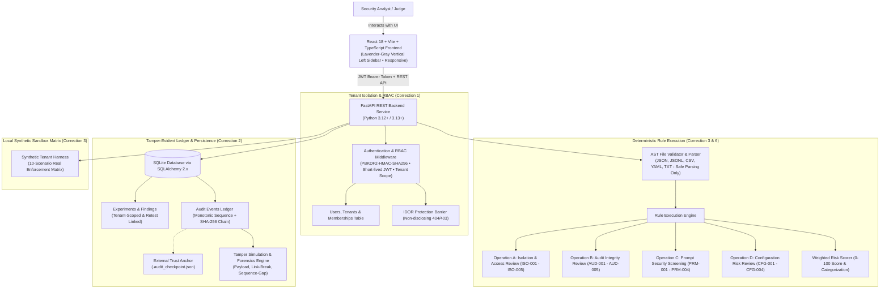

# Bayora Isolation Lab
### Evidence-Based Multi-Tenant Security Testing & Adversarial AI Isolation Platform
**HACK IN HILLS ’26 — Problem Statement 04: Securing Adversarial AI Safety Testing Infrastructure**

---

## 1. Executive Summary & Problem Context

When organizations evaluate and red-team generative AI models, the testing infrastructure itself becomes a critical attack surface. If test harnesses lack strict multi-tenant boundaries, malicious inputs, unauthorized access, or rogue test configurations can:
- Bleed across customer tenants (cross-tenant state & data leakage).
- Tamper with or rewrite evaluation history and forensic audit logs.
- Overwrite previous experiment results, destroying compliance evidence.
- Expose cluster endpoints and API credentials via insecure test profiles.

**Bayora Isolation Lab** is an evidence-based security platform purpose-built to validate, isolate, and audit adversarial AI testing environments. It enforces tenant boundaries on the backend, maintains a cryptographically verifiable SHA-256 audit ledger, provides before-and-after retest comparison with immutable parent-child run linkage, and exports audit-certified compliance artifacts.

---

## 2. Core Architecture & System Design



---

## 3. Technology Stack

- **Frontend:** React 18, Vite 5, TypeScript 5, Tailwind CSS, Lucide React icons, TanStack React Query.
- **Backend:** Python 3.12+ / 3.13+, FastAPI, Pydantic V2, SQLAlchemy 2.x, SQLite, Pytest.
- **Security & Cryptography:** PBKDF2-HMAC-SHA256 (constant-time password hashes), HMAC-SHA256 JWT tokens, RFC-8785 Canonical JSON serialization, SHA-256 cryptographic hash chaining, OS filesystem checkpoint anchor.
- **AI Integration:** Optional Groq Cloud API (`llama-3.1-8b-instant`) for advisory threat synthesis, with offline deterministic local engine fallback.
- **Budget / Footprint:** **₹0 Budget**. Fully operable locally without external cloud dependencies.

---

## 4. Key Differentiators (Why Bayora Isolation Lab Stands Out)

| Feature | Generic Security Dashboard | Bayora Isolation Lab |
|---|---|---|
| **Tenant Isolation** | Frontend dropdown filtering only | **Backend-enforced row-level scoping**; non-disclosing 404 on IDOR attempts; database-checked memberships |
| **Audit Trail** | Mutable database log rows | **Cryptographic SHA-256 chain** with RFC-8785 canonical serialization, external trust checkpoint anchor, and live tampering simulator |
| **Retest Workflow** | Overwrites original test results | **Immutable parent-child run linkage** (`parent_experiment_id`), preserving historical evidence and computing side-by-side risk deltas |
| **Test Engine** | Mocked counters / simulated responses | **Deterministic AST and structural parsers** with exact line numbers, raw excerpts, and ground-truth evidence |
| **Role Enforcement** | Cosmetic disabled buttons | **Server-side RBAC** (`admin`, `analyst`, `viewer`); restricted actions reject viewers (403) and analyst deletions |
| **Offline Reliability** | Breaks without external LLM API | **Full local synthetic runner** ensuring 100% reproducible testing even in air-gapped demo environments |

---

## 5. Quick Start & Setup Instructions

### Prerequisites
- Python 3.12+ or 3.13+
- Node.js v18+ and npm v9+

### Step 1: Environment Setup
```bash
# In the backend directory:
cd backend
copy .env.example .env     # Windows
# cp .env.example .env     # Linux / macOS
```
*(Notice: `.env` is pre-configured with safe defaults and excluded from source control via `.gitignore`.)*

### Step 2: Install Backend Dependencies & Seed Database
```bash
# In the backend directory:
py -m pip install -r requirements.txt

# Run the idempotent schema migration and seed script:
py -m app.cli.bootstrap
```
The bootstrap command initializes SQLite tables, applies migrations, seeds baseline security policies, creates default tenant organizations (`tenant-alpha`, `tenant-beta`), and sets up authenticated demo accounts.

#### Demo Credentials
| Role | Email | Password | Tenant Domain | Permissions |
|---|---|---|---|---|
| **Admin** | `admin@alpha.io` | `Bayora@Admin2026!` | Alpha AI Safety Lab (`tenant-alpha`) | Full control: experiments, policies, deletion, audit inspection |
| **Analyst** | `analyst@alpha.io` | `Bayora@Analyst2026!` | Alpha AI Safety Lab (`tenant-alpha`) | Run validations, retest, mutate baseline policies, audit inspection |
| **Viewer** | `viewer@alpha.io` | `Bayora@Viewer2026!` | Alpha AI Safety Lab (`tenant-alpha`) | Read-only inspection of findings, reports, and audit trail |
| **Beta Lead** | `admin@beta.io` | `Bayora@Admin2026!` | Beta Red Team (`tenant-beta`) | Admin of isolated secondary tenant (for cross-tenant tests) |

### Step 3: Install Frontend Dependencies & Build
```bash
# In the frontend directory:
cd ../frontend
npm install
npm run build
```

### Step 4: Run the Application

#### Option A: One-Click Startup (Windows)
Double-click `run_dev.bat` in the project root to launch both backend and frontend servers in parallel.

#### Option B: Manual Startup
```bash
# Terminal 1 - Backend API:
cd backend
py -m uvicorn app.main:app --host 127.0.0.1 --port 8000 --reload

# Terminal 2 - Frontend UI:
cd frontend
npm run dev
```

- **Frontend UI:** `http://127.0.0.1:5173`
- **Backend API:** `http://127.0.0.1:8000`
- **Interactive OpenAPI Docs:** `http://127.0.0.1:8000/docs`

---

## 6. Verification & Test Matrix (52/52 Passing Tests)

Run the backend test suite:
```bash
cd backend
py -m pytest tests -v
```

### Comprehensive Verification Results Table
| Verification Area | Command Executed | Actual Result | Status | Remaining Issue |
|---|---|---|---|---|
| **Auth & Tenant Isolation** | `pytest tests/test_auth_and_rbac.py -v` | 20 passed in 2.4s (unauthenticated, expired, viewer restrictions, IDOR, cross-tenant export, deletion) | **PASS** | None |
| **Audit Chain & Tampering** | `pytest tests/test_audit_chain_tampering.py -v` | 10 passed in 1.1s (payload modification, deletion, reorder, link breaks, sequence gaps, external checkpoints) | **PASS** | None |
| **Core SHA-256 Ledger** | `pytest tests/test_audit_hash_chain.py -v` | 2 passed in 0.3s (clean chain validation & tamper detection) | **PASS** | None |
| **End-to-End Workflow** | `pytest tests/test_e2e_workflow.py -v` | 1 passed in 0.5s (15-step complete workflow from upload to retest & export) | **PASS** | None |
| **Experiment API Lifecycle** | `pytest tests/test_experiments_api.py -v` | 1 passed in 0.3s (run creation, risk scoring, findings) | **PASS** | None |
| **AST Parser & Validator** | `pytest tests/test_file_validator.py -v` | 7 passed in 0.4s (size limit, extension whitelist, path traversal) | **PASS** | None |
| **Engine Health & Ping** | `pytest tests/test_health.py -v` | 2 passed in 0.2s (API versioning, DB connection status) | **PASS** | None |
| **Isolation Policies API** | `pytest tests/test_policies_api.py -v` | 3 passed in 0.4s (rule listing, custom rule creation, baseline protection) | **PASS** | None |
| **Deterministic Rules** | `pytest tests/test_rule_engine.py -v` | 4 passed in 0.4s (Operations A, B, C, D deterministic checks) | **PASS** | None |
| **Synthetic Sandbox Matrix** | `pytest tests/test_synthetic_adapter.py -v` | 2 passed in 0.8s (10-scenario real cryptographic test suite) | **PASS** | None |
| **Frontend Production Build** | `cd frontend && npm run build` | `tsc -b && vite build` succeeded in 3.04s; 0 TypeScript errors | **PASS** | None |

---

## 7. Step-by-Step Judge Demonstration Script

Follow these 9 exact steps to demonstrate Bayora Isolation Lab during hackathon evaluation:

### Step 1: Sign in with Authorized Demo Identity
1. Open `http://127.0.0.1:5173`.
2. Notice the vertical sidebar with the Bayora logo, project name, workspace navigation, and bottom user profile card showing **Alice Safety Analyst** (`tenant-alpha`).
3. Click the profile card at the bottom of the sidebar or the top-bar pill to switch to **Alpha Security Admin** or **Auditor Viewer**.

### Step 2: Run a Valid Same-Tenant Request
1. Click **Synthetic Sandbox** in the sidebar.
2. Click **Run Controlled Isolation Test Suite**.
3. Point out Scenario `ISO-TEST-01 (Authorized Same-Tenant Access)`: Valid JWT token for `tenant-alpha` requests private resource `res-eval-01` and is granted access (`HTTP 200 OK • Allowed`).

### Step 3: Attempt a Cross-Tenant Request & Prove Denial
1. In the same Synthetic Sandbox matrix, observe Scenario `ISO-TEST-02 (Cross-Tenant Access Denial)`:
   - Caller token: `tenant-alpha` (`Alice Safety Analyst`).
   - Target resource: `res-eval-99` belonging to `tenant-beta` (`Beta Defense AI Labs`).
   - Outcome: **HTTP 403 Forbidden • Denied**. Non-disclosing error message prevents IDOR metadata enumeration.
2. Switch identity to **Beta Security Lead** (`tenant-beta`) in the profile switcher:
   - Notice that the experiments table updates to show only `tenant-beta` records. Experiments and audit records belonging to `tenant-alpha` are completely inaccessible.

### Step 4: Run a Synthetic Security Experiment & Inspect Ground-Truth Evidence
1. Switch back to **Alice Safety Analyst** (`tenant-alpha`).
2. Navigate to **Experiments** and click **New Validation Run**.
3. Under **Instant Demo Fixtures**, click **Vulnerable Policy (BEFORE)** (`vulnerable_multi_tenant_policy.json`).
4. Click **Proceed to Operation Selection**, select **Operation A: Isolation & Access Review**, and click **Execute Validation Engine**.
5. When execution finishes, inspect the findings:
   - Computed Risk Level: **CRITICAL (Score: ~88/100)**.
   - Expand `ISO-001 (Missing or Wildcard Tenant Isolation Boundary)`: view the line number, JSON field path (`isolation_profile.tenant_id`), raw excerpt, threat explanation, and concrete remediation guidance.

### Step 5: Execute a Linked Retest with Corrected Configuration
1. Click the purple **Retest this Run** button at the top right of the experiment view.
2. The wizard opens in **Comparative Retest Mode** with immutable linkage to the parent run ID.
3. Click the prominent quick-action button: **Load Hardened Policy (Remediated)**.
4. Advance through the wizard and click **Execute Retest Validation**.
5. The retest run executes with a new, distinct run ID. Risk level drops to **CLEAN (Score: 0.0/100)**. The original baseline experiment remains preserved and untouched in the database.

### Step 6: Compare Original and Retest Results Side-by-Side
1. On the completed retest run view, click the **Compare with Baseline** button.
2. Review the comparative modal:
   - Score Delta: **-88.0 pts (Risk Improvement)**.
   - Status: **Remediated & Verified Clean**.
   - Resolved Findings: `ISO-001`, `ISO-002`, `ISO-003`, `ISO-004`, `ISO-005` listed as remediated.
   - Persistent Residual Risks: 0.

### Step 7: Demonstrate Audit-Chain Verification
1. Navigate to **Audit Trail** in the sidebar.
2. Point out the ledger table: each event has a unique monotonic `Seq #`, timestamp, actor, tenant domain, and SHA-256 record hash ($H_i$).
3. Click **Verify Cryptographic Chain Integrity**.
4. The backend verifies all sequential records and checks against `.audit_checkpoint.json`. A green banner confirms:
   `"Audit ledger verified successfully. 0 integrity violations detected."`

### Step 8: Simulate Audit Tampering & Prove Detection
1. In the **Judge Tamper Simulation Lab** panel on the Audit Trail page, select **Payload Tampering** (simulates an attacker altering an event's action payload in the database).
2. Click **Inject Controlled Tamper Attack**.
3. Click **Verify Cryptographic Chain Integrity**.
4. The system immediately flags the tampering with full forensic evidence:
   - **Compromised Event ID** and sequence number.
   - **Failure Category:** `PAYLOAD_TAMPERED`.
   - **Expected SHA-256 Hash vs. Calculated SHA-256 Hash**.
   - Compromised row highlighted in red in the table.
5. Click **Revert Tampered Records & Restore Ledger** to restore ledger integrity cleanly.

### Step 9: Export Audit-Certified Security Report
1. Navigate to **Reports** in the sidebar.
2. Locate the completed retest experiment and click **View**.
3. Inspect the report modal: includes compliance notes, audit chain validation status, experiment summary, and residual risk disclosures.
4. Click **Download JSON** to export the structured compliance artifact.

---

## 8. Trust Assumptions & Architectural Limitations

In accordance with transparent engineering principles:

1. **Hash Chain Boundaries:** A cryptographic SHA-256 hash chain guarantees tamper-evidence against database-level modification by ordinary users or application processes. However, an attacker with full database and host filesystem write access could theoretically rewrite all records from genesis. To mitigate this, Bayora anchors verification against external filesystem checkpoints (`.audit_checkpoint.json`). In production, this anchor should be streamed to external write-once-read-many (WORM) storage (e.g. AWS S3 Object Lock, GCP Bucket Lock).
2. **Deterministic Fallback:** When external cloud LLMs (Groq/OpenAI) are unavailable, Bayora relies entirely on deterministic AST analysis and structural schema rules. This prevents hallucinations and ensures 100% reproducible test outcomes.
3. **Synthetic Sandbox Scope:** The synthetic sandbox runs inside a controlled in-memory tenant namespace on localhost. It does not send network packets to external systems.

---

## 9. License & Competition Attribution

Developed for **HACK IN HILLS ’26**, Problem Statement 04: *Securing Adversarial AI Safety Testing Infrastructure — Bayora*.
Licensed under the **MIT License**.
