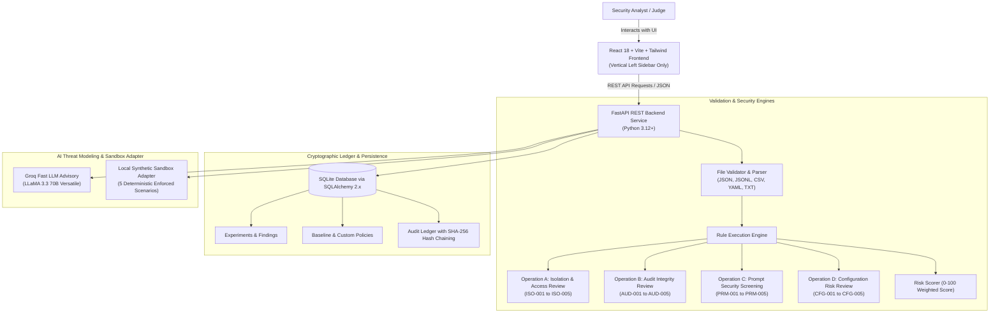

# Bayora Isolation Lab
### Full-Stack AI Security Validation Platform
**HACK IN HILLS ’26 — Problem Statement 04: Securing Adversarial AI Safety Testing Infrastructure**

---

## 1. Product Vision & Differentiator

When organizations perform red-teaming and safety testing on adversarial AI models, the testing infrastructure itself becomes a high-value attack surface. If test harnesses lack strict multi-tenant partitions, malicious prompts or rogue evaluations can bleed into neighboring customer tenants, poison shared evaluation memory, or tamper with forensic audit logs.

**Bayora Isolation Lab** provides an **evidence-based security validation workflow** that connects detection, mitigation recommendations, retesting, and residual-risk reporting:

1. **Upload Artifact:** Ingest JSON policies, JSONL prompt datasets, CSV test suites, TXT logs, or YAML configurations.
2. **Safe Multi-Format Parsing:** Files are parsed purely as declarative data trees; code is never executed.
3. **Select Security Operation:** Targeted rule engines for tenant isolation, audit log integrity, adversarial prompts, or configuration risks.
4. **Execute Deterministic Engine:** Real line-number extraction and ground-truth evidence gathering. Zero fabricated claims.
5. **Cryptographic SHA-256 Audit Hash Chaining:** Every action forms a tamper-evident chain verified on demand.
6. **Controlled Local Synthetic Sandbox:** An in-memory fixture proving cross-tenant denial, session memory partition, and identity enforcement without sending probes to arbitrary external IP addresses.
7. **Groq AI Threat Advisory (LLaMA 3.3):** Optional fast LLM inference providing STRIDE threat modeling and targeted mitigation advice.
8. **Downloadable Evaluation Reports:** Standardized JSON artifacts mapped to ISO/IEC 27001, NIST SP 800-53, and OWASP LLM01.

---

## 2. Architecture Overview



---

## 3. Technology Stack

- **Frontend:** React 18, Vite, TypeScript, React Router, Tailwind CSS, Lucide React icons, TanStack Query.
- **Backend:** Python 3.12+, FastAPI, Pydantic, SQLAlchemy 2.x, SQLite, Pytest.
- **AI Acceleration:** Groq Cloud Inference API (`llama-3.3-70b-versatile`) with automatic offline deterministic fallback.
- **Cost / Budget:** **₹0 Budget**. Fully runnable on a laptop with local SQLite and standard open-source tools.

---

## 4. Quick Start & Run Instructions

### Prerequisites
- Python 3.12+
- Node.js v18+ and npm

### 1. Setup Backend
```bash
# Navigate to backend directory
cd backend

# Create and activate virtual environment (optional)
python -m venv venv
# On Windows:
venv\Scripts\activate
# On Linux/macOS:
source venv/bin/activate

# Install backend dependencies
python -m pip install -r requirements.txt

# Start FastAPI server
python -m uvicorn app.main:app --host 127.0.0.1 --port 8000 --reload
```
The backend API is now live at: `http://127.0.0.1:8000`  
Interactive OpenAPI documentation: `http://127.0.0.1:8000/docs`

### 2. Setup Frontend
In a new terminal window:
```bash
# Navigate to frontend directory
cd frontend

# Install frontend dependencies
npm install

# Start Vite development server
npm run dev
```
The Bayora interface is now accessible at: `http://127.0.0.1:5173`

### 3. Seed Demonstration Data (Optional)
To pre-populate historical demonstration runs:
```bash
python scripts/seed_demo_data.py
```

---

## 5. Running Automated Tests

Bayora Isolation Lab includes a comprehensive automated test suite with **21 passing tests**:
```bash
# From the project root
python -m pytest backend/tests -v
```

### Verified Test Suite
- `test_health.py`: Verifies server health and version negotiation.
- `test_file_validator.py`: Path traversal prevention, extension validation, safe parsing.
- `test_rule_engine.py`: Deterministic checks for Operations A, B, C, and D.
- `test_audit_hash_chain.py`: Cryptographic SHA-256 hash chaining and tamper break detection.
- `test_policies_api.py`: Policy CRUD, enable/disable toggling, baseline rule protection.
- `test_synthetic_adapter.py`: Cross-tenant rejection, session memory isolation, unauthenticated denial.
- `test_experiments_api.py`: Full upload-to-report lifecycle.

---

## 6. Demonstration Walkthrough (Hackathon Presentation Script)

Follow these steps for a 3-minute hackathon demo:

1. **Overview Dashboard (`/`)**:
   - Show the clean SaaS interface featuring the **vertical left sidebar only** and cyan-to-blue Bayora "B" logo.
   - Point out that all statistics (Total Validations, Findings, Risk Score) are computed dynamically from SQLite, never hardcoded.

2. **Launch a Validation Run (`/experiments?new=true`)**:
   - In **Step 1 (Upload Artifact)**, click the demo fixture **"Vulnerable Multi-Tenant Policy (JSON)"**.
   - Notice that the server validates the file format, size, and sanitizes the filename.
   - Click **Proceed to Operation Selection**.
   - In **Step 2**, select **"A. Isolation & Access-Control Review"**. Read the operational scope and limitations.
   - In **Step 3**, notice the pre-checked **"Enable Groq AI Threat Advisory"** option.
   - Click **Execute Validation Engine**.

3. **Inspect Evidence-Grounded Results**:
   - View the calculated **Risk Meter (Critical 88/100)** and severity badges.
   - Expand the finding **"ISO-001: Missing or Wildcard Tenant Isolation Boundary"**.
   - Show the exact line-number and ground-truth code excerpt extracted from the JSON artifact.
   - Show the Groq AI Threat Advisory summarizing the STRIDE threat model and architectural patch.
   - Click **Download JSON Report** to show the formal compliance export.

4. **Forensic Audit Hash-Chain Verification (`/audit`)**:
   - Open the **Audit Trail** page.
   - Show the sequential records linked by SHA-256 hashes ($H_i$).
   - Click **"Verify Cryptographic Chain Integrity"**.
   - A green banner confirms zero tampering across the sequential ledger.

5. **Run Controlled Synthetic Sandbox (`/sandbox`)**:
   - Open **Synthetic Sandbox**.
   - Click **"Run Controlled Isolation Test Suite"**.
   - Watch all 5 scenarios pass in real time:
     - Scenario 1: Authorized In-Tenant Access (`200 OK`)
     - Scenario 2: Cross-Tenant Access Denial (`403 Forbidden`)
     - Scenario 3: Cross-Session State Isolation (`403 Forbidden`)
     - Scenario 4: Missing Identity Context (`401 Unauthorized`)
     - Scenario 5: Forged Token Signature (`401 Unauthorized`)

6. **Policy Governance (`/policies`)**:
   - Show baseline rules (`ISO-001` through `CFG-003`).
   - Demonstrate the interactive toggle to enable/disable rules.
   - Show that baseline rules are protected against accidental deletion.

---

## 7. Known Limitations & Security Assumptions

1. **Static vs. Runtime Inspection:** Operations A, B, C, and D inspect declared artifact files. Static inspection evaluates configuration posture; runtime validation is tested via the synthetic adapter.
2. **Heuristic Screening:** Prompt injection review flags known adversarial jailbreak patterns and ChatML/Llama token boundaries. It does not claim mathematical impossibility of novel adaptive bypasses.
3. **Sandbox Scope:** The synthetic adapter operates against local in-memory fixtures to guarantee safety without requiring cloud API keys or external network probes.

---

## 8. License

Developed for **HACK IN HILLS ’26**, Problem Statement 04. Open-source under the MIT License.
