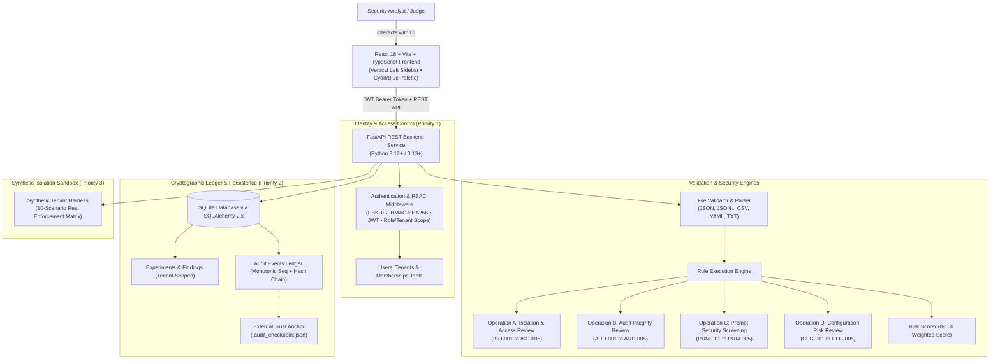

# Bayora Isolation Lab
### Full-Stack Adversarial AI Security Validation & Multi-Tenant Isolation Platform
**HACK IN HILLS ’26 — Problem Statement 04: Securing Adversarial AI Safety Testing Infrastructure**

---

## 1. Product Vision & Differentiator

When organizations perform red-teaming, jailbreak simulations, and safety evaluations on adversarial AI models, the testing infrastructure itself becomes a high-value attack surface. If test harnesses lack strict multi-tenant partitions, malicious inputs or rogue evaluations can bleed into neighboring customer tenants, poison shared evaluation memory, or tamper with forensic audit logs.

**Bayora Isolation Lab** provides an **evidence-based security validation and tenant isolation platform** that connects identity verification, deterministic rule analysis, comparative retesting, residual-risk reporting, and cryptographic ledger verification:

1. **Authentication & Multi-Tenant Authorization:** Actual identity verification with PBKDF2-HMAC-SHA256 password hashing, cryptographically signed short-lived JWT access tokens, role-based access control (`admin`, `analyst`, `viewer`), and server-enforced tenant scoping. Request headers (`X-Tenant-ID`) are validated strictly against caller database memberships.
2. **Deterministic Artifact Analysis:** Safely parses JSON policies, JSONL prompt datasets, CSV test suites, TXT logs, or YAML configurations. File content is parsed purely as declarative ASTs; code is never executed.
3. **Four Targeted Rule Operations:**
   - **Operation A (Isolation & Access Review):** Detects wildcard tenant boundaries (`ISO-001`), overly permissive permissions (`ISO-002`), insecure cross-session state reuse (`ISO-003`), missing boundary enforcement (`ISO-004`), and default allow fallbacks (`ISO-005`).
   - **Operation B (Audit Log Integrity Review):** Identifies missing timestamps (`AUD-001`), broken SHA-256 chain links (`AUD-002`), duplicate event sequence numbers (`AUD-003`), actor spoofing (`AUD-004`), and insecure storage bindings (`AUD-005`).
   - **Operation C (Prompt Security Screening):** Heuristically inspects prompt datasets for instruction override signatures (`PRM-001`), delimiter confusion (`PRM-002`), toxic payload patterns (`PRM-003`), and unsafe tool invocation schemas (`PRM-004`).
   - **Operation D (Configuration Risk Review):** Scans for hardcoded secrets/API keys (`CFG-001`), unsafe network bindings `0.0.0.0` (`CFG-002`), disabled TLS/SSL (`CFG-003`), and unauthenticated endpoints (`CFG-004`).
4. **Audit-Chain Robustness & External Checkpoint Anchor:** Every critical event is committed with a monotonic sequence number and deterministic canonical JSON SHA-256 hash. A read-only verification engine detects modifications, deletions, reorderings, broken links, and duplicate sequences. An external trust anchor (`.audit_checkpoint.json`) provides tamper-evidence even against database mutation attempts.
5. **Deterministic 10-Scenario Synthetic Isolation Matrix:** A live, repeatable sandbox test suite that executes actual security boundary code, cryptographic token validation, role boundaries, and session memory isolation—reporting granular outcomes (`PASS`, `FAIL`, `ERROR`, `SKIPPED`) with real evidence.
6. **Immutable Comparative Retesting:** Retests are linked to their baseline run via `parent_experiment_id`, enabling before-and-after risk comparison without overwriting historical forensic records.
7. **Downloadable Evaluation Reports:** Standardized JSON artifacts mapped to ISO/IEC 27001, NIST SP 800-53, and OWASP LLM01.

---

## 2. Architecture Overview



---

## 3. Technology Stack

- **Frontend:** React 18, Vite, TypeScript, React Router, Tailwind CSS, Lucide React icons, TanStack Query.
- **Backend:** Python 3.12+ / 3.13+, FastAPI, Pydantic V2, SQLAlchemy 2.x, SQLite, Pytest.
- **Security:** PBKDF2-HMAC-SHA256 (constant-time password verification), PyJWT / HMAC-SHA256 cryptographic tokens, canonical deterministic JSON serialization, SHA-256 audit chaining.
- **AI Acceleration (Optional):** Groq Cloud Inference API (`llama-3.1-8b-instant`) with offline deterministic fallback.
- **Cost / Budget:** **₹0 Budget**. Fully runnable locally on a laptop with SQLite and zero paid external dependencies.

---

## 4. Quick Start & Setup Instructions

### Prerequisites
- Python 3.12+ or 3.13+
- Node.js v18+ and npm

### 1. Environment Configuration
Create your local `.env` from the provided template:
```bash
# In the backend directory:
cd backend
copy .env.example .env     # On Windows
# cp .env.example .env     # On Linux / macOS
```
> **Security Notice:** `.env`, `bayora.db`, and `.audit_checkpoint.json` are strictly ignored by `.gitignore`. Never commit secrets or private keys to source control.

### 2. Install Backend Dependencies & Bootstrap Database
```bash
# In the backend directory:
py -m pip install -r requirements.txt

# Run the idempotent database migration & bootstrap command:
py -m app.cli.bootstrap
```
The bootstrap command creates the required SQLite tables, runs migrations, seeds baseline security policies, creates default tenant organizations (`tenant-alpha`, `tenant-beta`), and sets up demo users.

#### Default Demo Accounts
| Role | Email | Password | Tenant Domain |
|---|---|---|---|
| **Admin** | `admin@alpha.io` | `Bayora@Admin2026!` | Alpha AI Safety Lab (`tenant-alpha`) |
| **Analyst** | `analyst@alpha.io` | `Bayora@Analyst2026!` | Alpha AI Safety Lab (`tenant-alpha`) |
| **Viewer** | `viewer@alpha.io` | `Bayora@Viewer2026!` | Alpha AI Safety Lab (`tenant-alpha`) |
| **Admin** | `admin@beta.io` | `Bayora@Admin2026!` | Beta Red Team (`tenant-beta`) |
| **Analyst** | `analyst@beta.io` | `Bayora@Analyst2026!` | Beta Red Team (`tenant-beta`) |

*(Passwords can be customized prior to bootstrapping via environment variables `BAYORA_ADMIN_PASSWORD`, `BAYORA_ANALYST_PASSWORD`, and `BAYORA_VIEWER_PASSWORD`).*

### 3. Install Frontend Dependencies & Build
```bash
# In the frontend directory:
cd ../frontend
npm install

# Test production build:
npm run build
```

### 4. Running the Development Servers

#### Option A: One-Click Runner (Windows)
Double-click `run_dev.bat` in the project root to start both backend and frontend servers in separate windows.

#### Option B: Manual Startup
```bash
# Terminal 1 - Backend:
cd backend
py -m uvicorn app.main:app --host 127.0.0.1 --port 8000 --reload

# Terminal 2 - Frontend:
cd frontend
npm run dev
```

- **Frontend Application:** `http://127.0.0.1:5173`
- **Backend API:** `http://127.0.0.1:8000`
- **Interactive OpenAPI Documentation:** `http://127.0.0.1:8000/docs`

---

## 5. Automated Test Suite (45 Passing Tests)

Run the full automated test suite containing unit, security, tampering, and end-to-end integration tests:

```bash
# From the backend directory:
py -m pytest -v
```

### Verified Test Breakdown
| Test Suite | Tests | Purpose / Coverage |
|---|---|---|
| `test_auth_and_rbac.py` | 13 | Unauthenticated rejection, invalid tokens, expired JWTs, role checks (`admin`, `analyst`, `viewer`), cross-tenant experiment/finding/report IDOR rejection, and header spoofing resistance (`X-Tenant-ID`). |
| `test_audit_chain_tampering.py` | 10 | Cryptographic chain verification, payload tampering detection, middle-event deletion detection, sequence reordering detection, broken hash link detection, duplicate sequence numbers, malformed hash rejection, read-only immutability, and full-database rewrite detection via external checkpoint. |
| `test_synthetic_adapter.py` | 2 | Executes the 10-scenario synthetic isolation matrix; asserts all scenarios return correct expected outcomes (`PASS`), structured evidence, and zero unexpected errors. |
| `test_e2e_workflow.py` | 1 | Complete 15-step end-to-end user workflow: login, file validation error handling, artifact analysis, finding inspection, linked retest creation, comparative risk reduction, audit chain verification, JSON report export, and cross-tenant access denial. |
| `test_experiments_api.py` | 1 | Experiment creation, execution lifecycle, risk scoring, and finding retrieval. |
| `test_file_validator.py` | 7 | File size limits (10MB), extension whitelisting, malformed JSON handling, and path traversal prevention. |
| `test_health.py` | 2 | System health status and API version negotiation. |
| `test_policies_api.py` | 3 | Policy listing, custom policy creation, and baseline policy immutability. |
| `test_rule_engine.py` | 4 | Deterministic inspection for Operations A, B, C, and D. |
| `test_audit_hash_chain.py` | 2 | Core SHA-256 hash chaining and break detection. |
| **Total** | **45** | **100% Pass Rate (0 failures)** |

---

## 6. End-to-End Demonstration Walkthrough (Hackathon Presentation Script)

Follow this 3-minute sequence to demonstrate the hardened security workflow:

### Step 1: Authentication & Role Switcher
1. Open `http://127.0.0.1:5173`.
2. Notice the top navigation bar displays the authenticated identity (e.g. `analyst@alpha.io • Alpha AI Safety Lab`).
3. Click the user pill in the top right to switch between `admin@alpha.io`, `analyst@alpha.io`, `viewer@alpha.io`, or `admin@beta.io`.

### Step 2: Upload Artifact & Run Baseline Analysis (`/experiments?new=true`)
1. Click **New Validation Run**.
2. In **Step 1 (Upload Artifact)**, click the demo fixture **"Vulnerable Multi-Tenant Policy (JSON)"** (or upload your own JSON/YAML/JSONL/CSV file).
3. Click **Proceed to Operation Selection**.
4. In **Step 2**, select **"A. Isolation & Access-Control Review"**. Read the operational scope and limitations.
5. In **Step 3**, click **Execute Validation Engine**.

### Step 3: Inspect Ground-Truth Evidence & Findings
1. View the calculated **Risk Meter (Critical 88/100)** and summary count cards.
2. Expand the finding **"ISO-001: Missing or Wildcard Tenant Isolation Boundary"**.
3. Point out the exact line number, extracted field path (`tenant_id`), ground-truth code snippet, and remediation guidance.
4. Click **Download JSON Report** to export the structured compliance report.

### Step 4: Perform a Linked Comparative Retest
1. On the experiment detail view, click **New Retest**.
2. Notice that the wizard pre-populates the baseline parameters and displays the **Comparative Retest Mode** banner:
   `"This validation run will be recorded with immutable parent linkage to baseline experiment [ID]"`.
3. In Step 1, select a remediated policy (or click **"Strict Multi-Tenant Policy (JSON)"**).
4. Click **Execute Validation Engine**.
5. Observe that the retest run is created as an independent, immutable record linked to the parent run, with a lower residual risk score.

### Step 5: Verify Forensic Audit Ledger & Tamper Detection (`/audit`)
1. Navigate to **Audit Trail** in the left sidebar.
2. Point out that each audit event has a **Monotonic Sequence Number** (`Seq #`), actor email, tenant domain, and cryptographic SHA-256 record hash ($H_i$).
3. Click **"Verify Cryptographic Chain Integrity"**.
4. The system cryptographically recomputes hashes across the ledger and verifies against `.audit_checkpoint.json`, displaying a green verification status:
   `"Audit ledger verified successfully. 0 integrity violations detected across [N] sequential records."`

### Step 6: Run the 10-Scenario Synthetic Isolation Matrix (`/sandbox`)
1. Navigate to **Synthetic Sandbox**.
2. Click **"Run Controlled Isolation Test Suite"**.
3. Watch the 10 live security scenarios execute and display granular evidence:
   - **Authorized Same-Tenant Access:** Valid user accesses permitted resource (`PASS` / Allowed).
   - **Cross-Tenant Access Denial:** Tenant A requests Tenant B's private resource (`PASS` / Denied 404/403).
   - **Cross-Session State Isolation:** Session A requests Session B's private scratchpad (`PASS` / Denied 403).
   - **Missing Identity Context:** Request has no credentials (`PASS` / Denied 401).
   - **Invalid Identity Signature:** Forged JWT cryptographic signature (`PASS` / Denied 401).
   - **Expired Identity Token:** Expired credentials (`PASS` / Denied 401).
   - **Missing Tenant Context:** Caller has no tenant membership (`PASS` / Denied 403).
   - **Role Violation:** Viewer attempts an admin-only policy mutation (`PASS` / Denied 403).
   - **Cross-Tenant Report Export Denial:** Tenant A requests Tenant B's report (`PASS` / Denied 404).
   - **Authorized Retest:** User retests permitted experiment with chained audit events (`PASS` / Allowed).

---

## 7. Security Limitations & Trust Assumptions

In accordance with transparent application security principles:

1. **Audit Hash Chains vs. Complete Host Compromise:**
   - **What SHA-256 Chaining Guarantees:** Detects modification of past events, deletion of middle events, event reordering, duplicate sequence numbers, and tampering relative to the trusted external checkpoint (`.audit_checkpoint.json`).
   - **Limitations:** A hash chain stored locally in SQLite cannot, by itself, prevent an attacker who possesses root/filesystem access from deleting both the database and the checkpoint file simultaneously. For enterprise production, checkpoints should be streamed to an external write-once-read-many (WORM) storage service (e.g. AWS S3 Object Lock, GCP Bucket Lock, or a remote syslog server).
2. **Static vs. Runtime Inspection:**
   - Operations A, B, C, and D inspect static configuration files and prompt datasets for known vulnerability patterns. Static evaluation confirms configuration posture; runtime validation is tested via the synthetic sandbox harness.
3. **Prompt Screening Scope:**
   - Prompt injection analysis screens for known adversarial token delimiters, ChatML tags, and system override signatures. It is an initial defensive filter and does not guarantee mathematical impossibility of novel adaptive adversarial inputs.
4. **Synthetic Sandbox Boundaries:**
   - The synthetic sandbox operates strictly within a controlled in-memory tenant namespace. It does not send network packets to external IP addresses.

---

## 8. License

Developed for **HACK IN HILLS ’26**, Problem Statement 04. Open-source under the MIT License.
