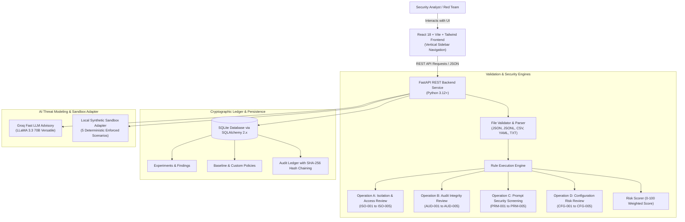

# Bayora Isolation Lab: Architecture & Technical Specification

Bayora Isolation Lab is an evidence-based security validation platform designed to assess whether AI safety testing infrastructure correctly isolates tenants, sessions, test artifacts, access permissions, and audit evidence.

## System Architecture

## Core Subsystems

### 1. Analysis Engine & Operations
- **Operation A (Isolation & Access-Control Review):** Analyzes tenant boundaries, wildcard grants, shared memory flags, and storage directory path scoping.
- **Operation B (Audit Log Integrity Review):** Enforces mandatory schema attributes, ISO-8601 timestamps, duplicate ID collision detection, and sequential SHA-256 hash chaining.
- **Operation C (Prompt-Injection Review):** Heuristic screening for instruction overrides, ChatML/Llama delimiter injections, and tool command execution attempts.
- **Operation D (Configuration Risk Review):** Scans for exposed API keys, unencrypted HTTP endpoints, and 0.0.0.0 bindings.

### 2. Cryptographic Audit Hash Chaining
Every meaningful event generates an audit entry where:
$$H_i = \text{SHA-256}(\text{CanonicalJSON}(\text{Payload}_i \parallel H_{i-1}))$$
Any deletion, alteration, or reordering breaks the chain and is flagged immediately by the `/api/audit-events/verify-chain` endpoint.

### 3. Controlled Synthetic Sandbox Adapter
Implements a dedicated in-memory test fixture proving cross-tenant denial, session memory partition, and identity enforcement with zero third-party network egress.
